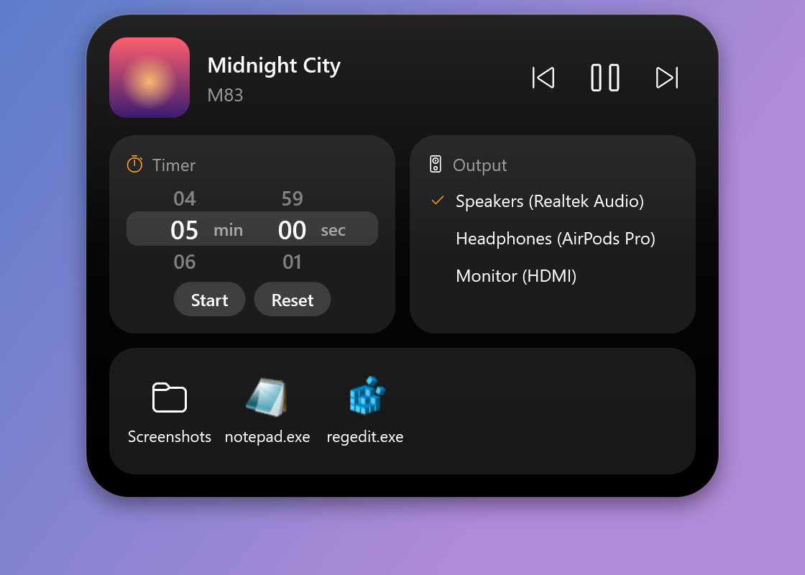

# Dynamic Island for Windows

An iOS-style **Dynamic Island** for Windows. It hides as a tiny tab at the top of your screen, flows out
like a liquid droplet when your pointer comes near, and opens into a panel with music controls, a timer,
audio output switching and a file shelf.

Built with C# / WPF on .NET 8. Its motion uses physically based springs modelled on Apple's
*Designing Fluid Interfaces* guidance.

<p align="center">
  
</p>

## Screenshots

| | |
|---|---|
| **Hidden:** a 40×5 px tab against the top edge<br> | **Reveal:** the tab stretches down and pinches off like a droplet<br> |
| **Compact pill:** shows what's going on (here, music)<br> | **Two activities:** the timer takes the pill and music splits into a bubble<br> |
| **Timer alert:** opens by itself, shakes and rings until clicked<br> | **Expanded panel**<br> |

*The screenshots are rendered from the app itself with demo data (`DynamicIsland.exe --screenshots <folder>`).*

## Features

### The island
- **Hidden tab:** almost invisible when idle, just a small glossy tab at the top-center of the screen.
- **Droplet reveal:** move the pointer to the tab and it stretches downward, a liquid neck pinches off the edge, and it settles into a floating pill. Hiding plays the same motion in reverse.
- **Click to expand** the pill into a larger panel of widgets.
- **Smart auto-hide:**
  - The pill hides once the pointer has been away for a moment.
  - The expanded panel stays open until you click somewhere else, so you can drag files onto it at your own pace.
  - It stays open while you're dragging, using a menu, or typing.
- **Interruptible spring motion:** every animation can be reversed mid-flight without jumping.
- **Glossy black glass** with a subtle edge highlight and a soft shadow.

### Widgets
- **Now playing:**
  - Album art, title and artist, plus previous / play-pause / next.
  - Works with Spotify, browsers and any app that appears in Windows' media controls.
  - The pill shows small artwork and animated sound bars.
- **Timer:**
  - iOS-style minute and second wheels: scroll, drag with momentum, or click.
  - When it ends, the island opens by itself, shakes, and plays an alarm for 15 seconds.
  - The alert stays until you click it, which also stops the sound.
- **Two things at once:** with a timer running and music playing, the pill shows the timer and a round bubble shows the album art, like on iOS.
- **Audio output switching:** pick the speakers or headphones Windows plays through, straight from the island.
- **File shelf:** drop files on the island to park them, then drag them out into any app later.
- **Video picture-in-picture (Chrome / Edge):** click the artwork to send the playing video into the browser's PiP, even when the browser is in the background. This needs the small included extension; see [setup](#picture-in-picture-setup).

### Windows integration
- **Window behavior:** transparent outside the island, no window border, no taskbar button, and nothing in Alt+Tab.
- **Displays:** multi-monitor and per-monitor DPI scaling. Choose the display and horizontal position in Settings.
- **Tray icon:** opens **Settings** and **Quit**.
- **Fullscreen:** hides automatically during fullscreen games and apps.
- **Start with Windows:** optional.

## Install

**Requirements:** Windows 10 (2004 or later) or Windows 11, and the [.NET 8 SDK](https://dotnet.microsoft.com/download/dotnet/8.0).

```powershell
git clone https://github.com/jatinkeswani/dynamic-island-for-windows.git
cd dynamic-island-for-windows/DynamicIsland

# Build and install to your user programs folder
dotnet publish DynamicIsland.csproj -c Release -o "$env:LOCALAPPDATA\Programs\DynamicIsland"
Start-Process "$env:LOCALAPPDATA\Programs\DynamicIsland\DynamicIsland.exe"
```

To have it start automatically, turn on **Start with Windows** in Settings (tray icon → Settings…).

## Usage

| Action | What happens |
|---|---|
| Move the pointer to the tab at the top of the screen | The island flows out into the compact pill |
| Click the pill | Opens the full panel |
| Click anywhere else / press Esc | Closes the panel / collapses it to the pill |
| Drag files onto the pill | It opens so you can drop them on the shelf |
| Drag a file out of the shelf | Drops it into any app (Explorer, chat, email…) |
| Click the album art (browser video) | Sends the video to picture-in-picture |
| Right-click the island or use the tray icon | Settings and Quit |

### Settings
Everything applies instantly and is saved to `%APPDATA%\DynamicIsland\settings.json`:

- **Placement:** display, and horizontal offset from the center.
- **Activation area:** its width (default 90 px) and height.
- **Safe margin** around the island (default 60 px).
- **Hide delay** (default 500 ms).
- **Reveal animation** speed (default 400 ms).
- **Hide during fullscreen apps.**
- **Start with Windows.**

### Picture-in-picture setup
Windows doesn't let one app take a video out of another, so PiP uses a tiny companion browser extension
(included in the app folder as `BrowserExtension`):

1. Tray icon → **Settings…** → **Open extension folder**.
2. In Chrome go to `chrome://extensions` (in Edge, `edge://extensions`), turn on **Developer mode**, click **Load unpacked**, and pick that folder.
3. In `chrome://extensions/shortcuts`, make sure *"Open the playing video in picture-in-picture"* is **Ctrl+Shift+9** and set to **Global**.

Clicking the album art in the island then puts the playing tab's video into the browser's own PiP window.

## Notes and limitations

- **Audio output switching** uses `IPolicyConfig`, an undocumented Windows interface (also used by EarTrumpet and SoundSwitch), because Windows has no public API for it. It works on current Windows 10 and 11 but could change in a future update.
- **Picture-in-picture** only works for videos in Chromium browsers (Chrome, Edge, Brave…), and uses the browser's own PiP window. Some sites block PiP.
- **The file shelf** keeps links to your files, not copies, and empties when the app quits.

## Project structure

```
DynamicIsland/
  MainWindow.xaml(.cs)        The island: states, spring animation, geometry, hover/auto-hide, widgets
  MainWindow.Screenshots.cs   Renders README screenshots with demo data (--screenshots)
  Spring.cs                   Damped spring (damping ratio + response, Apple-style)
  MediaService.cs             Now playing via Windows media controls
  AudioOutputs.cs             Playback device list and default-device switching
  IslandTimer.cs              Drift-free countdown
  WheelPicker.cs              iOS-style number wheel
  SettingsWindow.cs, Settings.cs, TrayIcon.cs, NativeMethods.cs
  BrowserExtension/           Chrome/Edge extension for video picture-in-picture
  PROJECT.md                  Detailed architecture notes
docs/screenshots/             README images
```

See [`DynamicIsland/PROJECT.md`](DynamicIsland/PROJECT.md) for the architecture in depth.

## License

[MIT](LICENSE)
